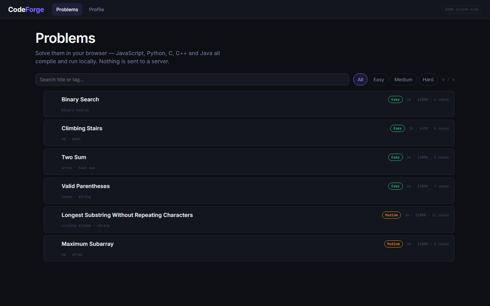
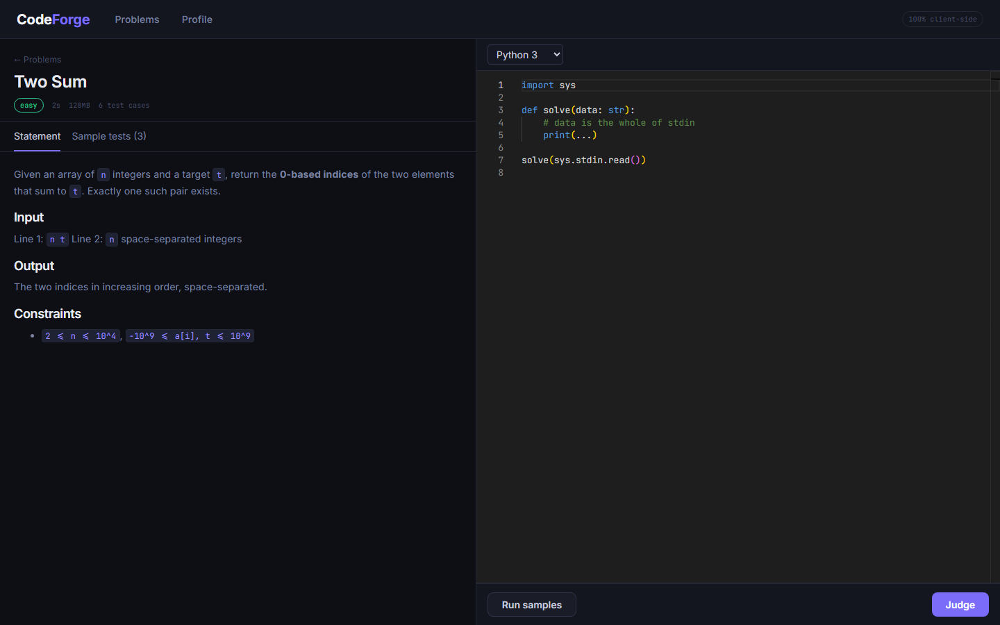
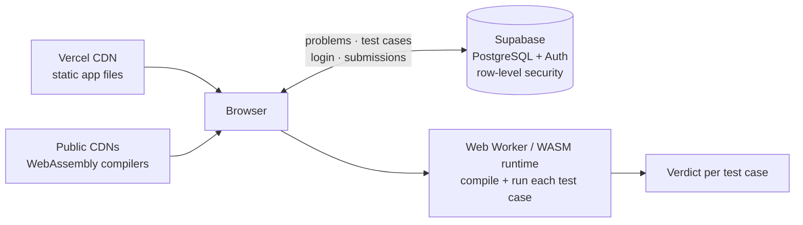

# CodeForge

**Practice competitive programming in your browser.** Write a solution in JavaScript,
Python, C, C++ or Java, and CodeForge compiles it, runs it against every test case and
gives a judge verdict, all on your own machine using WebAssembly. Admins publish their
own problems, and every logged-in submission is saved to a progress dashboard. There is
no backend server to run: the browser talks directly to a Postgres database whose
security rules are enforced by the database itself.

### 🔗 Live demo: **[codeforge-arena.vercel.app](https://codeforge-arena.vercel.app)**





---

## Features

**For everyone**
- **5 languages, all executed in the browser:** JavaScript, Python 3, C, C++ and Java
- **Real judge verdicts:** Accepted, Wrong Answer, Time Limit Exceeded, Memory Limit
  Exceeded, Runtime Error and Compile Error, with runtime and memory per test case
- **Custom input:** run your code on your own input and see exactly what it prints
- **Monaco editor** (the editor used in VS Code), with drafts auto-saved per problem and language
- **Guest mode:** solve without an account; progress stays in the browser

**With an account** (email + password)
- **Every judged submission is saved:** verdict, tests passed, runtime, language and code
- **Progress dashboard:** problems solved out of the total, a breakdown by difficulty,
  acceptance rate and recent submissions
- **My submissions** per problem, with one click to load old code back into the editor

**For admins**
- **Create problems** with a Markdown description (with live preview), difficulty, tags,
  time and memory limits, and test cases with expected outputs
- **Draft → publish:** drafts are visible only to their author until published
- **Edit, unpublish or delete only the problems you created**, enforced by the database,
  not just hidden in the UI

## How it works



| Language | Runs on |
|---|---|
| JavaScript | A throwaway Web Worker per run |
| Python 3 | [Pyodide](https://pyodide.org) (CPython compiled to WebAssembly) |
| C / C++ | Clang + LLVM compiled to WebAssembly ([emception](https://github.com/jprendes/emception)); the program then runs in CodeForge's own WebAssembly runner |
| Java | [CheerpJ](https://cheerpj.com) (a JVM running in WebAssembly) — needs `tools.jar` deployed, see Known limitations |

**Judging**
- **Time Limit Exceeded:** each test case has a wall-clock limit. A run that goes over
  is stopped by terminating its Web Worker.
- **Memory Limit Exceeded:** exact for Python and C/C++, measured from the size of the
  program's WebAssembly heap (it only grows, so its final size is the peak). Browsers
  can't measure a JavaScript worker's memory, so for JavaScript only a real
  out-of-memory crash counts, and the page says so.
- **Fast input:** C/C++ programs get their whole input at once, so even 10⁵-number
  inputs run in about 100 ms.
- **Small page loads:** opening a problem downloads only its sample tests; the full test
  set (it can be megabytes) is fetched once, when you first click Judge.
- **Output check:** exact comparison that tolerates trailing whitespace and Windows line
  endings, plus a floating-point checker with relative/absolute tolerance.
- **Cross-origin isolation:** COOP/COEP headers unlock `SharedArrayBuffer`, which the
  C/C++ runtime needs to feed input to a compiled program.

**Security without a backend.** The browser uses Supabase's public key, so every rule
lives in the database as **row-level security** ([`supabase/schema.sql`](supabase/schema.sql)):

| Who | Can | Can't |
|---|---|---|
| Guest | read published problems and their test cases | submit, see anyone's data |
| User | save own submissions, read own history and stats, rename themselves | create problems, see others' submissions, make themselves admin |
| Admin | create problems; edit, publish and delete **their own** | touch another admin's problems or the built-in ones |

Saving a problem with its test cases is one database function (`save_problem`), so a
problem is never half-saved. [`scripts/db-test-rls.mjs`](scripts/db-test-rls.mjs) checks
22 of these rules against the real database by acting as a guest, a user and two admins,
then rolls everything back.

## Key design decisions

**1. No backend for practice.** CodeForge started with a conventional server judge: an
Express API, MongoDB, a Redis + BullMQ job queue, and a fresh, locked-down Docker
container for every submission. That judge works and is still in [`server/`](server)
and [`judge/`](judge). For practice it was deliberately **not** deployed:

| | Server judge (MERN + Redis) | In-browser judge (shipped) |
|---|---|---|
| Hosting cost | Paid servers + maintenance | **$0** (static hosting + free database tier) |
| Scaling | Add more workers | Every user brings their own CPU |
| Security | Must safely run strangers' code | User's code only runs on their own machine |
| Trust in verdicts | **Authoritative** | Can be faked by the user, for their own account only |

The server judge is kept for a future **contest mode**, where hidden test cases and
trusted verdicts need a server.

**2. PostgreSQL instead of MongoDB for the serverless version.** Without a backend, the
database has to enforce security on its own, and PostgreSQL's row-level security does
exactly that. The data is also relational (users → submissions → problems → test cases)
and the dashboard is aggregation-heavy, which SQL handles naturally.

Design notes and problems found along the way are in [`FINDINGS.md`](FINDINGS.md).

## Tech stack

| Area | Technologies |
|---|---|
| Frontend | React 19, Vite 8, React Router, Monaco Editor |
| In-browser runtimes | WebAssembly, Web Workers, Pyodide, emception (Clang/LLVM), CheerpJ |
| Data & auth | Supabase (PostgreSQL, Auth, row-level security) |
| Hosting | Vercel (static), service worker caching, COOP/COEP headers |
| Server judge (not deployed) | Node.js, Express, MongoDB, Redis, BullMQ, Docker, Python |
| Testing | Node.js built-in test runner, database security tests |

## Project structure

```
client/                   the live web app
  src/judge/              in-browser judge: one runner per language + output checker
  src/pages/              Problems, Solve, Dashboard, Login, Admin (list + editor)
  src/lib/                Supabase client, auth, problems, submissions, form validation
  content/problems/       built-in problems (JSON), loaded into the database on setup
  vercel.json             hosting config: headers, caching, SPA routing
supabase/schema.sql       tables, row-level security rules, database functions
scripts/
  db-setup.mjs            apply the schema, load built-in problems, grant admin
  db-test-rls.mjs         security-rule tests against the real database
  deploy-vercel.mjs       one-command deploy
server/                   Express + MongoDB + Redis judge API (not deployed)
judge/                    Docker image + sandbox supervisor for the server judge
.github/workflows/        keeps the free database from pausing
```

## Run locally

Requires Node.js 20.19+ and a Supabase project.

1. Create `client/.env.local`:
   ```
   SUPABASE_URL="https://<project>.supabase.co"
   SUPABASE_PUBLISHABLE_KEY="sb_publishable_..."
   POSTGRES_URL="postgresql://...pooler.supabase.com:5432/postgres"
   ```
   In Supabase, turn off **Authentication → Email → Confirm email**.
2. Then:
   ```bash
   npm install
   npm run db:setup     # create tables + security rules, load built-in problems
   npm run db:test      # check the security rules (leaves no data behind)
   npm run dev          # http://localhost:5173
   npm test             # unit tests
   ```
3. Sign up in the app, then make yourself an admin:
   ```bash
   npm run db:setup -- --make-admin you@example.com
   ```

## Deploy

Set `SUPABASE_URL` and `SUPABASE_PUBLISHABLE_KEY` as environment variables on the
Vercel project, then run:

```bash
npm run deploy
```

See [`client/DEPLOY.md`](client/DEPLOY.md).

## Known limitations

- **Test cases reach the browser** because that's where judging happens, so a technical
  user can read the expected outputs. Truly hidden test cases need the server judge.
- **Verdicts are computed and saved by the browser,** so a user could fake results for
  their own account. They can't touch anyone else's data.
- C, C++ and Java are **experimental**. Their first run downloads a 20–45 MB toolchain
  (skipped until you actually run code when the browser is in data-saver mode).
- **Java is switched off until a Java 8 `tools.jar` is deployed** at the site root
  (`client/public/tools.jar`). CheerpJ reads javac from there; without it the page
  shows Java as unavailable. Java also needs Chrome or Edge on this site.
- JavaScript memory isn't measured (no browser exposes a worker's heap size).
- Supabase's free tier pauses a project after a week without activity; a scheduled
  GitHub Action pings it every three days.
