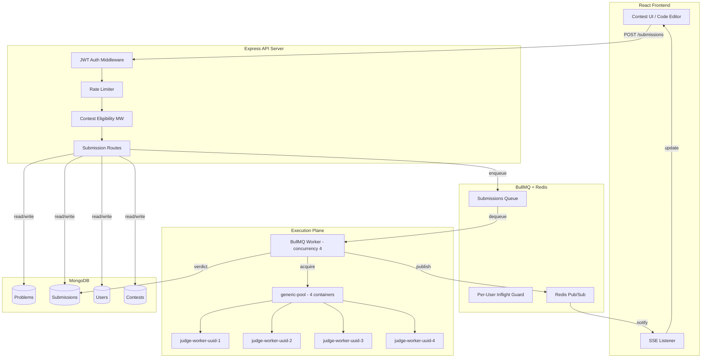
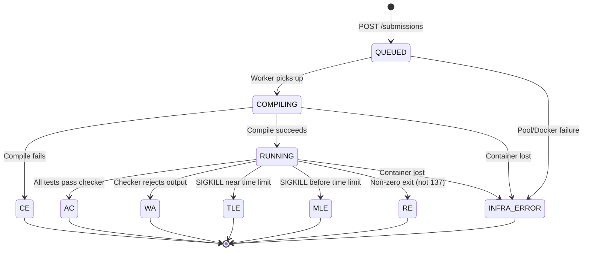
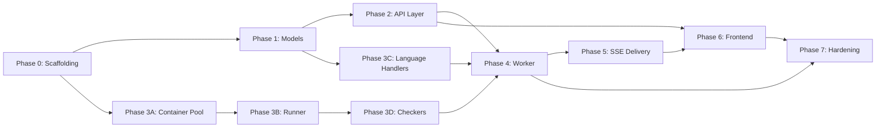

# CodeForge Arena v3 — Implementation Plan

> **Source**: [codeforge-arena-v3-hardened.md](file:///d:/mern/codeforge-arena-v3-hardened.md)
> **Stack**: MongoDB · Express · React · Node.js · Docker · Redis · BullMQ

---

> ## ⚠️ Superseded by v4
>
> This v3 plan was implemented, then rebuilt. The current spec is
> **[`codeforge-arena-v4.md`](file:///d:/mern/codeforge-arena-v4.md)**; deviations and
> their reasoning are in **[`FINDINGS.md`](file:///d:/mern/FINDINGS.md)**.
>
> What changed (build order for the v4 rebuild):
>
> | Phase | Delivered |
> |---|---|
> | 0 | `config.js` (validated, prod fail-fast) · shared `redis.js` · `node --test` suite · `.env.example` fix |
> | 1 | private-test stripping on `GET /problems/:id` · IDOR gates · per-user idempotency · unified `status`/`verdict` state machine · SSE catch-up |
> | 2 | **execution engine rewrite** — ephemeral one-container-per-submission (`judge/sandbox.js`), in-container `judge/supervisor.py` (per-case timeout + `/proc` VmHWM + deterministic MLE), `judge/verdict.js`, stateless worker; deleted `containerPool.js`/`runner.js`/`cleanup.js` |
> | 3 | contest end-to-end — `contestId` threading · ICPC leaderboard (`src/leaderboard.js`, atomic Lua + Mongo rebuild) · `?contestId=` route · pretest/system-test split · frontend contest submit + real standings + `SubmissionPanel` |
> | 4 | in-browser practice judge (`client/src/judge/`) — JS + Python client-side; C/C++/Java practice → server judge (see FINDINGS F20) |
> | 5 | `special` checker (`supervisor.py` `check` mode + own sandbox) · admin problem/contest list-edit-delete |
> | 6 | this note · `codeforge-arena-v4.md` · `FINDINGS.md` |
>
> The v3 phase tables below are retained for historical context only.

---

## Architecture Overview



---

## Phase 0 — Project Scaffolding & DevOps Foundation

**Goal**: Mono-repo structure, dev tooling, Docker judge image, Redis + MongoDB running locally.

| # | Task | Output | Est. |
|---|------|--------|------|
| 0.1 | Initialize mono-repo with `server/` and `client/` workspaces | `package.json` (root), `server/`, `client/` | 1h |
| 0.2 | Server: Express + TypeScript/JS scaffold with nodemon | `server/src/index.js`, `server/.env.example` | 1h |
| 0.3 | Client: Vite + React scaffold | `client/` with Vite config | 30m |
| 0.4 | `docker-compose.yml` — MongoDB 7, Redis 7, plus build context for `fat-judge` | `docker-compose.yml` | 1h |
| 0.5 | Build `codeforge/fat-judge` Docker image (GCC, OpenJDK 21, Python 3.12, Node 20) | `judge/Dockerfile`, pinned digest | 2h |
| 0.6 | `.env` config for all secrets, `.gitignore` hardened | Config files | 30m |

**Acceptance**: `docker compose up` brings up Mongo, Redis, and 4 pre-built judge containers. Server starts on port 5000, client on port 5173.

### Key Files
```
d:\mern\
├── docker-compose.yml
├── judge/
│   └── Dockerfile              # fat-judge image (gcc, jdk, python, node)
├── server/
│   ├── package.json
│   ├── .env.example
│   └── src/
│       └── index.js            # Express entry point
└── client/
    ├── package.json
    └── src/
        └── App.jsx
```

---

## Phase 1 — MongoDB Data Models & Validation

**Goal**: Define all Mongoose schemas with the invariants from the architecture doc baked in.

| # | Task | File | Est. |
|---|------|------|------|
| 1.1 | `User` model — email, passwordHash, role (admin/contestant), timestamps | `server/src/models/User.js` | 30m |
| 1.2 | `Problem` model — title, slug, statement, testCases, `timeLimitSec`, `memoryLimitMB`, `checkerType`, constraints | `server/src/models/Problem.js` | 1h |
| 1.3 | `Contest` model — title, startTime, endTime, problemIds[], participants[] | `server/src/models/Contest.js` | 45m |
| 1.4 | `Submission` model — userId, problemId, contestId (nullable), code, language, status enum, verdict, runtime, memory, timestamps | `server/src/models/Submission.js` | 45m |
| 1.5 | `assertProblemLimits()` validation — reject problems where `timeLimitSec > 10` or `memoryLimitMB > 256` | `server/src/utils/validation.js` | 30m |

> [!IMPORTANT]
> `assertProblemLimits()` must run at **problem-save time** AND defensively at **job-enqueue time** (§1 of arch doc). This is a hard invariant — the queue's `lockDuration` depends on it.

### Submission Status Enum
```
QUEUED → COMPILING → RUNNING → AC | WA | TLE | MLE | RE | CE | INFRA_ERROR
```

---

## Phase 2 — API Layer & Middleware Stack

**Goal**: RESTful API with auth, rate limiting, contest eligibility, and idempotent submission ingestion.

| # | Task | File | Est. |
|---|------|------|------|
| 2.1 | JWT auth middleware (register/login/verify) | `server/src/middleware/auth.js`, `server/src/routes/auth.js` | 2h |
| 2.2 | Redis-backed sliding-window rate limiter (10 submissions/min/user) | `server/src/middleware/rateLimiter.js` | 1h |
| 2.3 | Contest eligibility middleware — time-window check + problem inclusion, demotes via `req.body.contestId = null` | `server/src/middleware/contestEligibility.js` | 1h |
| 2.4 | Idempotent submission ingestion — `Idempotency-Key` header + MongoDB unique `_id` with `11000` duplicate handling | `server/src/routes/submissions.js` | 1.5h |
| 2.5 | Per-user in-flight guard — `redis.set(inflight:${userId}, '1', 'NX', 'EX', 30)` | `server/src/middleware/inflightGuard.js` | 45m |
| 2.6 | Problem CRUD routes (admin-only) with `assertProblemLimits` on create/update | `server/src/routes/problems.js` | 1.5h |
| 2.7 | Contest CRUD routes (admin-only) | `server/src/routes/contests.js` | 1h |
| 2.8 | Leaderboard route — read from Redis ZSET, fallback rebuild from Mongo | `server/src/routes/leaderboard.js` | 1h |

### Middleware Execution Order (Critical)
```
JWT Auth → Rate Limiter → Inflight Guard → Contest Eligibility → Route Handler
```

> [!WARNING]
> The eligibility middleware must run **before** destructuring `req.body` in the route handler — it mutates `contestId` to `null` for ineligible submissions rather than rejecting them.

---

## Phase 3 — Docker Sandbox Execution Engine (Core)

**Goal**: The heart of the system — container pool, per-submission cgroup limits, compilation, execution, and verdict classification.

### 3A — Container Pool Manager

| # | Task | File | Est. |
|---|------|------|------|
| 3A.1 | `spawnContainer()` — `docker run -d` with all hardening flags from §2 | `server/src/judge/containerPool.js` | 1.5h |
| 3A.2 | `killContainer()` — `docker rm -f`, best-effort | Same file | 30m |
| 3A.3 | `validate()` — `docker inspect -f '{{.State.Running}}'` health check | Same file | 30m |
| 3A.4 | `generic-pool` setup — `min:4, max:4, testOnBorrow:true, acquireTimeoutMillis:20000` | Same file | 1h |
| 3A.5 | Submission counter per container + `RECYCLE_AFTER_N` (200) forced destroy | Same file | 30m |

#### Container Hardening Flags (verbatim from arch doc)
```bash
--init --user 1000:1000
--memory=256m --memory-swap=256m --cpus=1.0 --pids-limit=64
--network=none --cap-drop=ALL --security-opt=no-new-privileges
--read-only
--tmpfs /dev/shm:rw,nosuid,nodev,noexec,size=1k,mode=1777
--tmpfs /workspace:rw,size=64m,mode=1777,exec
```

### 3B — Submission Runner

| # | Task | File | Est. |
|---|------|------|------|
| 3B.1 | `setMemoryCeiling()` — `docker update --memory` per-submission cgroup control | `server/src/judge/runner.js` | 1h |
| 3B.2 | Compile step — separate `execFile` with `COMPILE_TIMEOUT_SEC=10`, independent of run timeout | Same file | 1h |
| 3B.3 | Run step — `timeout -s KILL ${timeLimitSec}s`, capture stdout/stderr | Same file | 1.5h |
| 3B.4 | `classifyResult()` — TLE vs MLE disambiguation via timing heuristic (exit 137 + `durationMs >= limit - 200ms`) | Same file | 1h |
| 3B.5 | `cleanupContainer()` — `pkill -9 -U 1000` + workspace purge for healthy reuse path | `server/src/judge/cleanup.js` | 45m |
| 3B.6 | `isInfraFailure()` — detect Docker daemon errors, missing containers, pool exhaustion | `server/src/judge/errors.js` | 45m |

### 3C — Language Handlers

| # | Task | File | Est. |
|---|------|------|------|
| 3C.1 | C/C++ handler — `gcc`/`g++` compile, `./a.out` run | `server/src/judge/languages/cpp.js` | 1h |
| 3C.2 | Python handler — no compile, `python3 solution.py` run | `server/src/judge/languages/python.js` | 30m |
| 3C.3 | Java handler — tokenizer with text-block support (§5), entry-class extraction with fallback, `-Xmx96m -XX:MaxMetaspaceSize=48m -XX:+UseSerialGC -XX:+UseContainerSupport` | `server/src/judge/languages/java.js` | 2h |
| 3C.4 | JavaScript handler — `node solution.js` run | `server/src/judge/languages/javascript.js` | 30m |

> [!IMPORTANT]
> **Java tokenizer ordering is critical**: text blocks (`"""..."""`) must be stripped **before** single-line string literals, or triple-quote delimiters break the regex. See §5 of arch doc.

### 3D — Verdict Checker

| # | Task | File | Est. |
|---|------|------|------|
| 3D.1 | `defaultChecker()` — line-trimmed, trailing-newline-insensitive exact compare | `server/src/judge/checkers/exact.js` | 30m |
| 3D.2 | `floatChecker()` — token-wise compare with absolute/relative epsilon | `server/src/judge/checkers/float.js` | 1h |
| 3D.3 | `specialChecker()` — external checker binary contract (named, stub for MVP) | `server/src/judge/checkers/special.js` | 30m |
| 3D.4 | Multi-test-case orchestration — run checker per test case, short-circuit on first WA | `server/src/judge/testRunner.js` | 1.5h |

---

## Phase 4 — BullMQ Worker & Job Lifecycle

**Goal**: Wire the queue, worker, and pool together with correct error handling semantics.

| # | Task | File | Est. |
|---|------|------|------|
| 4.1 | BullMQ queue setup — `lockDuration` computed from `MAX_ALLOWED_TIME_LIMIT_SEC + COMPILE_TIMEOUT_SEC + 5` | `server/src/queue/setup.js` | 1h |
| 4.2 | `processJob()` — acquire container, run submission, classify, update DB | `server/src/queue/worker.js` | 2h |
| 4.3 | `runInSandbox()` — the acquire/release/destroy orchestration from §2 | Same file | 1.5h |
| 4.4 | Poison/destroy path — infra failures and resource-ceiling hits force `pool.destroy()` | Same file | 1h |
| 4.5 | Inflight guard release — `redis.del(inflight:${userId})` in finally block | Same file | 15m |
| 4.6 | Leaderboard update — on AC, `ZADD` to contest ZSET with penalty time | Same file | 45m |

### Job Flow State Machine



> [!NOTE]
> **Verdicts are NOT failures.** TLE/MLE/WA are successful jobs with a result — they resolve normally. Only genuine infra faults (Docker daemon down, container missing) should throw and hit BullMQ's failed-job path.

---

## Phase 5 — Real-Time Verdict Delivery

**Goal**: Server-Sent Events (SSE) for live verdict updates to the client.

| # | Task | File | Est. |
|---|------|------|------|
| 5.1 | Redis Pub/Sub publisher — worker publishes verdict on channel `verdict:${submissionId}` | `server/src/realtime/publisher.js` | 45m |
| 5.2 | SSE endpoint — `GET /api/v1/submissions/:id/stream`, subscribes to Redis channel | `server/src/routes/submissionStream.js` | 1.5h |
| 5.3 | Auto-cleanup — unsubscribe on client disconnect, timeout after 60s | Same file | 30m |
| 5.4 | Client SSE hook with deduplication guard (`submissionId` set) and `COMPLETED` short-circuit | `client/src/hooks/useVerdictStream.js` | 1h |

---

## Phase 6 — React Frontend

**Goal**: A polished, premium contest platform UI with code editor, problem viewer, and live standings.

| # | Task | File | Est. |
|---|------|------|------|
| 6.1 | Design system — dark theme, color palette, typography (Inter/JetBrains Mono), animations | `client/src/index.css` | 2h |
| 6.2 | Auth pages — Login / Register with JWT token management | `client/src/pages/Auth.jsx` | 2h |
| 6.3 | Problem list page — filterable grid with difficulty tags | `client/src/pages/Problems.jsx` | 2h |
| 6.4 | Problem detail + code editor — Monaco Editor with language selector, sample test runner (WASM) | `client/src/pages/ProblemSolve.jsx` | 4h |
| 6.5 | Submission panel — live verdict via SSE, test case results, runtime/memory display | `client/src/components/SubmissionPanel.jsx` | 2h |
| 6.6 | Contest dashboard — timer, problem set, leaderboard | `client/src/pages/Contest.jsx` | 3h |
| 6.7 | Leaderboard — real-time standings with rank, penalty, solve count | `client/src/components/Leaderboard.jsx` | 1.5h |
| 6.8 | Admin panel — problem editor, contest manager, submission monitor | `client/src/pages/Admin.jsx` | 3h |
| 6.9 | Client-side WASM sample runner (instant feedback, non-authoritative) | `client/src/wasm/sampleRunner.js` | 3h |

> [!IMPORTANT]
> **Core Axiom**: The client may execute code via WASM for instant sample-test feedback, but it **may never be the source of a verdict, timing, or standings**. Every authoritative verdict comes from the server-side sandbox.

---

## Phase 7 — Hardening & Verification

**Goal**: Run every item on the architecture doc's verification checklist, plus load testing.

| # | Task | Est. |
|---|------|------|
| 7.1 | Verify `docker info --format '{{.CgroupDriver}}'` confirms cgroup v2 | 15m |
| 7.2 | Verify `docker exec <c> df -h /dev/shm` shows `1.0K` not `64.0M` | 15m |
| 7.3 | Force-kill a pooled container, confirm pool respawns within `acquireTimeoutMillis` | 30m |
| 7.4 | Submit Java: package-private class + text block — confirm correct extraction | 30m |
| 7.5 | Submit JVM solution near `memoryLimitMB` — confirm no false MLE | 30m |
| 7.6 | Confirm `assertProblemLimits` rejects invalid problem configs | 15m |
| 7.7 | Load test: 50 concurrent submissions, verify queue backpressure and no pool starvation | 1h |
| 7.8 | End-to-end contest simulation: 10 users, 5 problems, verify leaderboard correctness | 1h |

---

## Dependency Graph



**Critical path**: `P0 → P1 → P2 → P4 → P5 → P6 → P7` (API-first)
**Parallel track**: `P0 → P3A → P3B → P3D → P4` (execution engine)

---

## Estimated Total Effort

| Phase | Description | Estimate |
|-------|-------------|----------|
| 0 | Scaffolding & DevOps | ~6h |
| 1 | Data Models | ~3.5h |
| 2 | API & Middleware | ~9h |
| 3 | Execution Engine | ~14h |
| 4 | Worker & Queue | ~6.5h |
| 5 | Real-Time Delivery | ~3.75h |
| 6 | React Frontend | ~22.5h |
| 7 | Hardening & Verification | ~4h |
| **Total** | | **~69h** |

---

## Explicitly Deferred (from arch doc §Deferred)

These are **named trade-offs**, not gaps:

1. **Docker-socket trust boundary** — worker has host-root-equivalent access via socket. Acceptable for single-laptop MVP.
2. **Per-language memory tiers** — cgroup accounting is exact now, but adversarial memory tricks are out of scope.
3. **Ephemeral container-per-submission** — deferred in favor of hardened persistent pool for lower latency.
